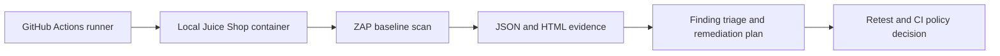

# NorthStar Application & API Security Lab

**Status:** Verified scan, selected-control mitigation, retest and browser-validation case study. Dependency and inline-style findings remain open.

## Objective

Demonstrate an application-security workflow appropriate for a Cloud Security Architect: isolate a deliberately vulnerable training application, discover passive web/API findings, triage them, document remediation patterns, and require scan evidence in CI.

OWASP Juice Shop is the target because it is deliberately insecure and intended for security training. This repository never targets public systems, client systems, or third-party applications without authorization.

## Architecture



The application only runs inside the ephemeral GitHub-hosted runner. The workflow uses no public exposure, cloud account, credentials or secrets.

## What the workflow does

1. Starts a pinned Juice Shop container on the runner.
2. Waits for the local service to become reachable.
3. Runs a ZAP baseline scan against `127.0.0.1:3000`.
4. Uploads JSON and HTML reports as workflow artifacts.
5. Keeps the scan exit code non-blocking for the initial evidence-collection run.

The initial `-I` scan setting is deliberate: Juice Shop is supposed to produce findings. It prevents an intentionally vulnerable lab from making every PR red before the review baseline is understood. It is **not** a production policy. After triage, the next step is to gate on agreed severities and documented exceptions.

## Scope and boundaries

| In scope | Out of scope |
|---|---|
| Local training container | Public Internet targets |
| Passive baseline ZAP scan | Exploitation of vulnerabilities |
| Sanitized findings and remediation analysis | Production security claims |
| CI artifact evidence | Claiming a vulnerability is fixed without a retest |

## Deliverables

- [Workflow](.github/workflows/zap-juice-shop.yml)
- [Finding triage template](docs/finding-triage.md)
- [Remediation and retest plan](docs/remediation-and-retest.md)
- [Completion matrix](docs/completion-matrix.md)

## Run locally (optional)

```bash
docker run --rm -d --name northstar-juice-shop -p 3000:3000 bkimminich/juice-shop:v19.1.1
curl --fail http://127.0.0.1:3000
docker run --rm --network host -v "$PWD/evidence:/zap/wrk" \
  ghcr.io/zaproxy/zaproxy:stable \
  zap-baseline.py -t http://127.0.0.1:3000 -J zap-report.json -r zap-report.html -I
docker rm -f northstar-juice-shop
```

Only run against this controlled lab. The GitHub Actions workflow is the preferred route while local Docker is unavailable.

## Recruiter-ready evidence after execution

> **Application & API Security Lab -** Built an isolated OWASP Juice Shop security-testing pipeline that runs ZAP baseline scanning in GitHub Actions, preserves JSON/HTML evidence, and ties findings to a documented triage, remediation and retest process. The workflow targets an intentionally vulnerable local training container only.

Do not use this wording until the workflow has completed successfully and the evidence is reviewed.

## References

- [OWASP Juice Shop](https://owasp.org/projects/juice-shop)
- [OWASP ZAP baseline scan](https://www.zaproxy.org/docs/docker/baseline-scan/)
- [ZAP GitHub Action](https://github.com/zaproxy/action-baseline)


## Verified results

[Read the verified case study and remaining risks](docs/verified-results.md).

Baseline and gateway scans each covered 95 URLs. CSP/CORS response controls,
restricted image sources, Chromium compatibility checks and the selected-control
CI gate passed. Earlier setup instructions describe the initial workflow;
the current workflow performs baseline and gateway retesting.
